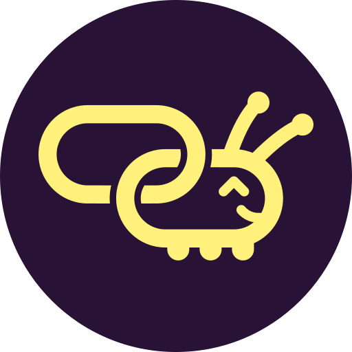
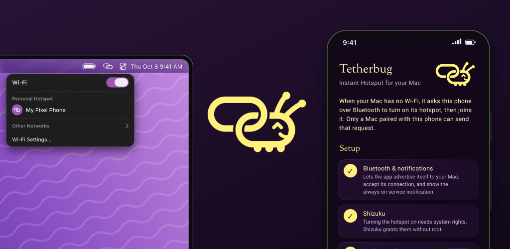
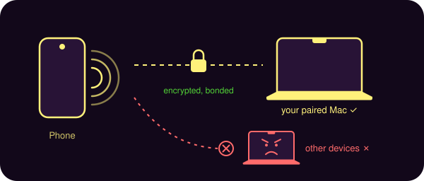
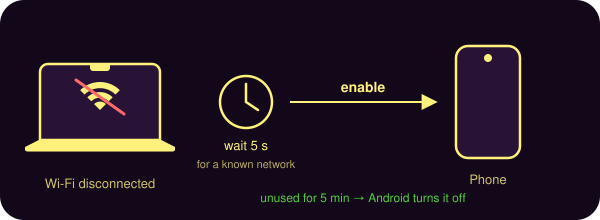
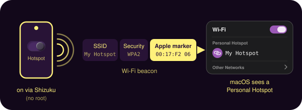
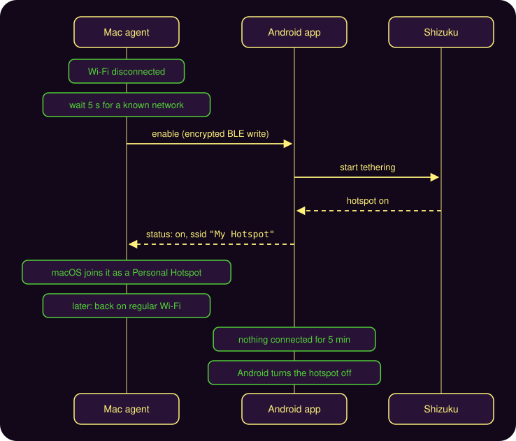
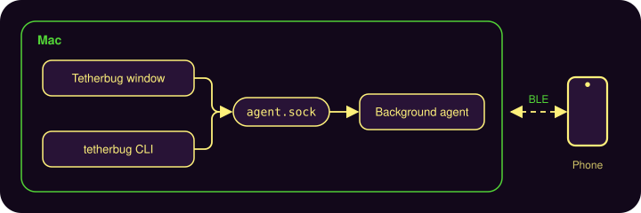
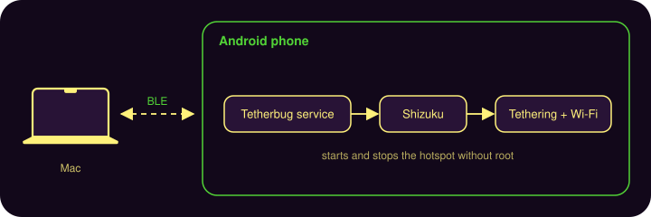
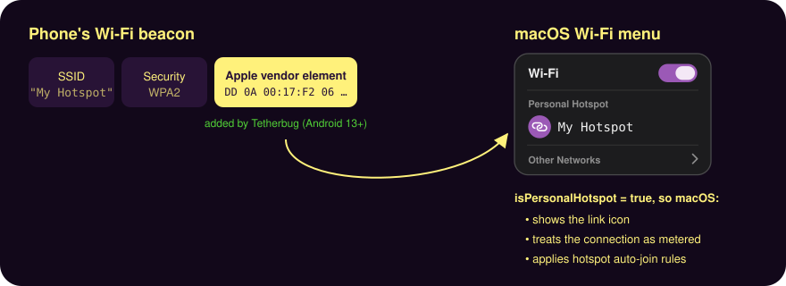

<picture><source media="(prefers-color-scheme: light)" srcset="assets/icon/icon-light.svg"></picture>

# Tetherbug

Apple's Instant Hotspot, for an Android phone and a Mac. When your Mac loses
Wi-Fi, it asks the phone over Bluetooth to turn its hotspot on, and the
hotspot advertises itself the way an iPhone's does, so macOS treats it as a
Personal Hotspot: link icon in the Wi-Fi menu, a metered connection, and the
usual hotspot auto-join rules.

<picture><source media="(prefers-color-scheme: light)" srcset="assets/readme/hero-light.png"></picture>

## How it works

1. The **Android app** runs a small foreground service that advertises a
   Bluetooth LE service. Only a Mac paired with the phone can read its status
   or send it commands (the link is encrypted and bonded).

   <picture><source media="(prefers-color-scheme: light)" srcset="assets/images/step-pair-light.svg"></picture>
2. The **Mac app**'s background agent stays connected to the phone. When Wi-Fi
   stays disconnected for 5 seconds it asks for the hotspot. Once nothing has
   been connected to the hotspot for a while, Android turns it off again; the
   phone app can shorten that to a few minutes.

   <picture><source media="(prefers-color-scheme: light)" srcset="assets/images/step-wifi-drops-light.svg"></picture>
3. The phone turns its hotspot on through [Shizuku](https://shizuku.rikka.app)
   (no root) and can add Apple's Personal Hotspot marker to its Wi-Fi beacon,
   which is what makes macOS recognise it.

   <picture><source media="(prefers-color-scheme: light)" srcset="assets/images/step-hotspot-on-light.svg"></picture>

### When Wi-Fi disconnects

<picture><source media="(prefers-color-scheme: light)" srcset="assets/images/wifi-drops-light.svg"></picture>

### The pieces

<picture><source media="(prefers-color-scheme: light)" srcset="assets/images/pieces-mac-light.svg"></picture>

<picture><source media="(prefers-color-scheme: light)" srcset="assets/images/pieces-phone-light.svg"></picture>

The phone and Mac talk over a small, documented [BLE protocol](docs/protocol.md).
The Mac app has a window for status, the hotspot switch, its password and
settings, plus a `tetherbug` command for scripts and
[SketchyBar](docs/sketchybar.md).

## Getting started

- **Phone:** install the Android app (Android 13+), then follow its setup
  checklist: Bluetooth and notification permissions, Shizuku, start the
  service. Turn on **Look like an iPhone hotspot** for the Personal Hotspot
  marker, and pick how soon an unused hotspot turns off.
- **Mac, fastest with Nix:** `nix run github:xav-ie/Tetherbug`, or install it
  with the [nix-darwin module](docs/macos.md#with-nix-fastest) (macOS 14+).
- **Mac, everything else:** see [Tetherbug for Mac](docs/macos.md) for pairing,
  settings and other ways to install.
- **SketchyBar:** see [Tetherbug in SketchyBar](docs/sketchybar.md).

Releases aren't published yet; until then, use Nix or build from source ([Development](docs/development.md)).

## Documentation

- [Tetherbug for Mac](docs/macos.md): installing, pairing, settings and the `tetherbug` command
- [Tetherbug in SketchyBar](docs/sketchybar.md)
- [Development](docs/development.md): repository layout and building each piece
- [BLE protocol](docs/protocol.md): how the phone and Mac talk

## How macOS recognises a Personal Hotspot

<picture><source media="(prefers-color-scheme: light)" srcset="assets/images/beacon-light.svg"></picture>

macOS decides a network is a personal hotspot from an Apple vendor element in
the Wi-Fi beacon (OUI `00:17:F2`, type 6, `DD0A0017F206010103010000`).
`-[CWNetwork isPersonalHotspot]` checks for it, and it drives the link icon in
the Wi-Fi menu, the metered ("expensive") interface and the hotspot auto-join
rules. The saved known-network `PersonalHotspot` flag does not. The separate
"Personal Hotspot" section with battery bars is Continuity over BLE tied to an
Apple Account, and is out of reach.

Android 13+ can add vendor elements to its hotspot through the system-only
`SoftApConfiguration.Builder#setVendorElements`, which the shell uid (adb or
Shizuku) may call. The setting persists in the hotspot config, and takes
effect the next time the hotspot starts.

## References

- [Configure an access point as a personal hotspot](https://www.yichya.dev/configure-access-point-as-personal-hotspot/):
  adding the Apple vendor element to an OpenWrt hostapd config makes macOS
  treat the AP as a Personal Hotspot; the element used here comes from it.
- [MikroTik forum: Apple personal hotspot vendor element](https://forum.mikrotik.com/viewtopic.php?t=199314):
  the same trick on RouterOS.
- [Android metered hotspots](https://www.lorier.net/docs/android-metered.html):
  Android marks its hotspot metered via DHCP option 43 `ANDROID_METERED`,
  which macOS ignores.
- [`SoftApConfiguration.java`](https://android.googlesource.com/platform/packages/modules/Wifi/+/refs/heads/main/framework/java/android/net/wifi/SoftApConfiguration.java):
  `Builder#setVendorElements` (Android 13+, `@SystemApi`).
- [Apple Platform Security: Instant Hotspot](https://support.apple.com/guide/security/instant-hotspot-security-seca4b33e8c9/web):
  why the Continuity "Personal Hotspot" section can't be reproduced.
