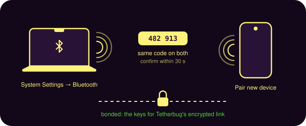

# Tetherbug for Mac

Tetherbug keeps a Bluetooth link to your Android phone and asks it to turn its hotspot on when your
Mac loses Wi-Fi. It has a window for status and settings, a background agent that does the work, and
a `tetherbug` command-line tool.

## 1. Set up the phone

Install the Tetherbug Android app from the
[releases page](https://github.com/gbettineschi/Tetherbug/releases), then follow its setup checklist:
Bluetooth permissions (notifications are optional), [Shizuku](https://shizuku.rikka.app) (hotspot control needs
system rights), and start the service.

## 2. Pair the phone with your Mac

1. On your Mac, open **System Settings → Bluetooth** and leave it open so the Mac stays discoverable.
2. On the phone, open **Bluetooth settings → Pair new device** and pick your Mac.
3. Check that both screens show the same code and confirm on both within 30 seconds. If it times out,
   Android forgets the Mac; just pair again.

<p align="center"><picture><source media="(prefers-color-scheme: light)" srcset="../assets/images/pairing-light.svg"></picture></p>

Pairing also gives Tetherbug the keys for its encrypted Bluetooth LE link, so there's no second
prompt. Only a paired Mac can read the phone's status or turn its hotspot on.

## 3. Install Tetherbug

### With Nix (fastest)

Try it without installing anything:

```sh
nix run github:gbettineschi/Tetherbug
```

To install it for good with [nix-darwin](https://github.com/nix-darwin/nix-darwin), add the flake and
enable its module. That puts **Tetherbug.app** in `/Applications/Nix Apps`, the `tetherbug` command
on your `PATH`, and runs the background agent at login through launchd:

```nix
# flake.nix
inputs.tetherbug.url = "github:gbettineschi/Tetherbug";

# one of your darwinConfiguration's modules
{
  imports = [ inputs.tetherbug.darwinModules.default ];
  services.tetherbug.enable = true;
}
```

With the module you can leave **Launch at login** off: launchd already keeps the agent
running. Open Tetherbug once from Applications so macOS asks for Bluetooth access.

### Updates

Use this fork’s release downloads to retain the patches. See [personal releases](personal-releases.md) for signing and update details. Do not use the original author’s Homebrew cask: it installs upstream builds.

### From the releases page

Download `Tetherbug-v<version>.zip` from the
[releases page](https://github.com/gbettineschi/Tetherbug/releases), unzip it, and move **Tetherbug.app** to
Applications.

Tetherbug isn't notarized by Apple yet, so the first time you open a Homebrew or downloaded copy,
macOS blocks it. Allow it under **System Settings → Privacy & Security → Open Anyway**. Nix installs
aren't affected.

### From source

See [Development](development.md) to build the app yourself.

## 4. Run Tetherbug

Open Tetherbug and turn on **Launch at login**. macOS may ask you to allow it under
**System Settings → General → Login Items**, and asks once for Bluetooth access. The window then shows
your phone, its hotspot state and battery.

### Menu-bar control

The existing background agent also displays a native hotspot icon. No extra helper is needed.

- **Click or right-click:** open the native menu. Use the **Mobile Hotspot** switch to toggle the hotspot, or change **Automatic mode** in the menu.
- With **Automatic mode** on, turning the hotspot off pauses activation for **5 minutes**. Turning the hotspot on manually cancels the suspension.
- Click **Automatic Mode** to turn it off with no deadline, or click it again to resume. The checkmark appears only while automatic activation is active. **Turn off automatic mode for…** offers 15 minutes, 30 minutes, 1 hour, 2 hours, 3 hours, Today (until the next local midnight), and Indefinitely. Each choice replaces the previous deadline rather than adding to it. Indefinitely disables automatic mode with no expiry, just like clicking Automatic Mode off.
- A timed suspension shows **Turned off until…** beside Automatic Mode; mode switched off directly has no expiry label. Both menu entries remain available when automatic mode is off, including if disabled in Settings. Clicking Automatic Mode re-enables it; choosing a duration schedules it to resume at the new deadline.
- The pause survives sleep and agent restart. After it expires, automatic activation still requires
  enabled but disconnected Mac Wi-Fi and the configured disconnect wait. Connected Wi-Fi is left alone.
- The icon follows the phone's reported state. While awaiting confirmation, or if the phone/Shizuku
  is unavailable, clicking cannot issue another toggle. Errors appear in the menu and settings window.
- The native checkmark column keeps its space while Automatic Mode is off, so toggling the checkmark does not shift the command labels.

Keep **Launch at login** enabled to retain the menu when the settings window closes. Without
it, the menu exists only while the window's session agent is running. Menu **Quit Tetherbug** exits
the agent and an open settings window; it does not turn off the phone's hotspot or unregister the login item.

This remains Tetherbug's Bluetooth/Shizuku integration. The native Personal Hotspot marker depends on the phone actually transmitting it (not verified on every firmware, and absent on the tested S23); the menu does not add Apple's off-state discovery to macOS Wi-Fi.

### Settings

| Setting | Default | What it does |
| --- | --- | --- |
| Turn on hotspot when Wi-Fi is disconnected | on | When Wi-Fi stays disconnected for the wait below, ask the phone to turn its hotspot on. |
| After disconnected for | 5 sec | How long to give macOS's own auto-join (which bursts on wake) before asking, in seconds (0–600). |
| Launch at login | off | Starts the agent at login and keeps it running when the window is closed. |

### Command line

```sh
tetherbug status          # phone, hotspot state, battery, signal (--json for scripts)
tetherbug enable          # ask the phone to turn its hotspot on
tetherbug disable         # ...or off
tetherbug watch           # one JSON line every time the state changes
tetherbug debug on        # notify for everything the agent does (off to stop)
```

Using SketchyBar? See [Tetherbug in SketchyBar](sketchybar.md).

## Build from source

Needs the Xcode command line tools.

```sh
git clone https://github.com/gbettineschi/Tetherbug
Tetherbug/macos/build.sh ~/Applications
open ~/Applications/Tetherbug.app
```

Run Mac policy, native-menu and settings-model tests with `bash macos/test.sh`. For a native menu
preview using simulated phone states and an isolated preferences suite, run `bash macos/test.sh preview`.
Neither command talks to a phone. These checks do not replace validation of Bluetooth/hotspot control
on an actual Android device.

If a Command Line Tools installation reports a missing `SwiftUIMacros` plugin with the macOS 27 SDK,
select an installed 26.x SDK using `SDKROOT` for both commands. This local build was verified with
`SDKROOT=/Library/Developer/CommandLineTools/SDKs/MacOSX26.5.sdk` and the macOS 14 deployment target.

## Cooldown after a nearby phone shutdown

In Automatic mode, a fresh On-to-Off phone status report starts a 5-minute pause only while the Tetherbug Bluetooth connection remains active. Wi-Fi loss by itself does not create a cooldown. Disconnecting Bluetooth clears the status baseline, so an Off state first discovered after reconnection does not count as a nearby shutdown. Automatic cooldowns do not shorten a longer user-selected suspension or re-enable mode that was switched off.

The pause is saved across app restarts and shown beside Automatic mode. Turning Mobile Hotspot on manually from the Mac cancels it. Repeated Off reports do not restart the timer. Android's existing status reports do not identify whether shutdown was manual or Samsung's native idle timeout: both can satisfy the nearby-connected criterion. This is a proximity rule, not proof of a voluntary shutdown.
